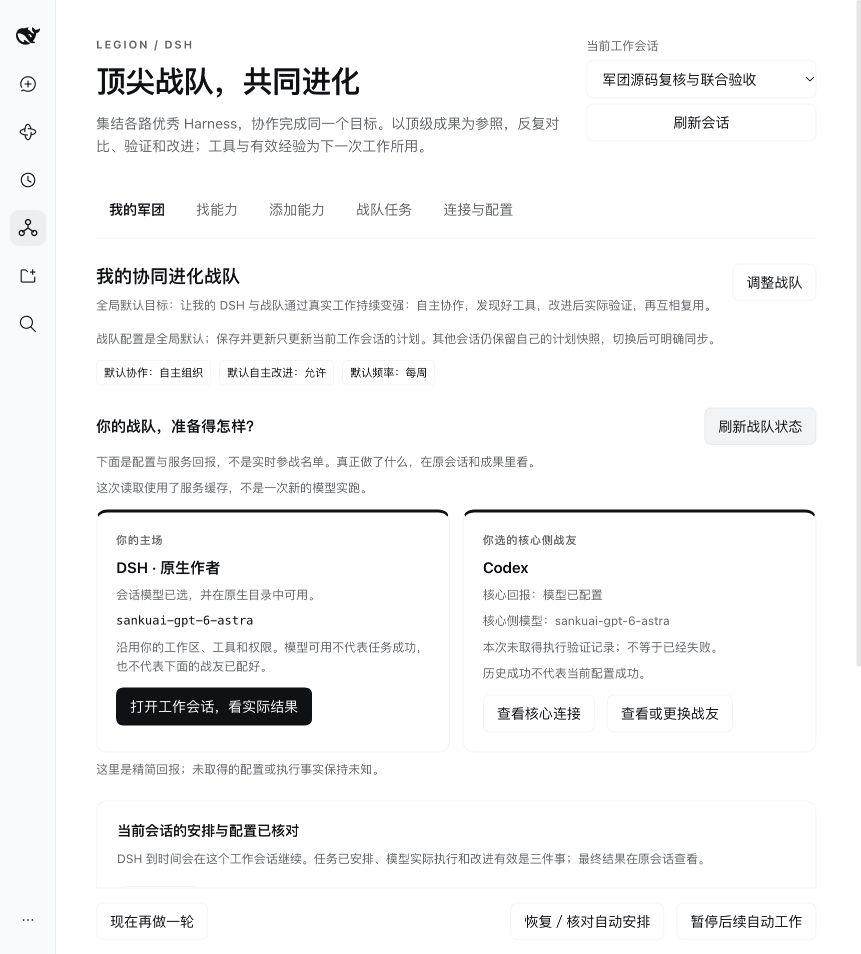

# Legion · 集结顶尖 Harness，共同进化，对标世界级成果

[English](README.md) | 简体中文

**你给一个目标，让一支顶尖 Harness 战队为你做成。** 自主研究、分工协作、互用工具；
以同类顶级作品为参照，反复对比、验证和改进，把同一个作品做完整，让有效改进为后续工作所用。

不绑定一家，向各路优秀 Harness 开放接入。“共同进化、对标世界级”是产品追求；
具体成员与成果以真实运行证据为准，不宣称全部成员已就绪或每次都达到世界第一。

从 DSH 开始：选战友、给目标，在原会话跟进任务和成果；需要委托成员工作时，连接你独立安装的军团核心。

**[0.5.1 安装说明](docs/MARKET.md#v051) · [打开 DSH 工作台](#安装后从侧栏打开工作台) · [产品定位与已验证范围](docs/PRODUCT.md)**



[观看改前／改后真实操作对比](https://github.com/seanliii/dsh-plugin-legion/releases/download/v0.5.1/dsh-v051-comparison.mp4) · 原速重放，章节之间有剪辑，无现场人声；不是模型工作耗时。

**当前定位：技术预览。** 0.5.0 验证了单 DSH 作者交付；0.5.1 已跑通 DSH 委托核心 Codex 独立评审、再由 DSH 独立复现并采纳反馈的限定双 Harness 协作。这轮有人介入，不是无人自治的战队进化。

**0.5.1：先看清你的战队。** 所选成员概览、事实投影与成员分页，分别呈现 DSH 作者模型和核心成员。[证据与发行状态](docs/PLAN.md#v051)

<a id="可以做什么"></a>

## 同一目标，互用工具，让改进传到整个战队

| 你关心的事 | 这个入口提供什么 |
|---|---|
| **一起把同一件事做完** | 选择候选与协作偏好，沿原任务、原会话接着修改，不从空白重开。 |
| **把合适的工具用起来** | 发现已有能力、读真实接口，通过获准的工具与消息入口，为原任务补位。 |
| **让有效改进能被复用** | Codex 审查提出问题，DSH 独立复现并修进产品；同一修复副本与合回源码均已回归验证。跨任务自动传播尚未证明。 |
| **不只做出来，还对标顶级成果** | 围绕当前目标寻找可核对的高水平参照，将实际差距带回同一作品继续改进；对标过程不冒充已经胜出。 |

**DSH 是入口，协同进化的战队才是产品。** 不是在菜单里挑一家助手，也不是让多个助手各交一份答案。[完整产品定义](docs/PRODUCT.md#one-team) · [机制与边界](docs/ECOSYSTEM.md#co-evolving-team)

## 立即开始

1. 用[**DSH“发现”页安装**](docs/MARKET.md#官方-discover-索引)，或按[固定 Git 命令](docs/MARKET.md#v051)安装，然后明确启用 Legion。两条路线都不要求本插件先发布到 npm。
2. 打开侧栏 **军团**，选择 **当前工作会话**，按 **选战友 → 定协作 → 自动变强**完成组队。自主改进默认开启；提交后保存偏好，由 DSH 原生任务安排首次与默认每周工作，可暂停并回原会话看结果。[完整流程与边界](docs/TEAM.md)
3. 需要委托工作时，[下载并核对核心 v0.1.0](docs/CORE.md#public-core-install)，建立 Python 3.12 全新环境，再按 **`init` → `serve` → `dsh-config` → 插件保存连接**接入；实际派单前配置本人模型。核心不随连接器打包或启动。

0.5.1 的固定 Git 目标如下；安装前请按[版本记录](docs/PLAN.md#v051)核对发行状态与包校验。`web` 是示例 profile，按需替换并保留 `-w`：

```sh
dsh plugin --profile web -w add 'github:seanliii/dsh-plugin-legion#v0.5.1'
```

用户使用自己的模型与账号，安装包不提供共享密钥。另行安装的[公开核心 v0.1.0](https://github.com/seanliii/meyo-legion-core/releases/tag/v0.1.0)同为技术预览：第一方 MIT，第三方原许可保留。任务安排、模型实际执行、改进有效分别核验。

把一件真实需求交给 DSH，例如：

```text
围绕这个目标，给我一份能实际使用、能接着修改的结果。
合适时与已配置成员协作；发现不足就回到原作品修，
不要各交一份互不相干的答案。
```

<details>
<summary>暂时没有核心？先使用发现能力、读源与原生工具。</summary>

可以直接进入 **找能力**；查当前 DSH 工具、Skill 和公开 GitHub 不需要军团核心。在普通 DSH 对话里说：

```text
帮我找能完成这件事的现成插件。先给来源和限制，不要安装。
```

</details>

[0.5.0 发布后回执：GitHub main](https://github.com/seanliii/dsh-plugin-legion/blob/main/docs/PLAN.md#v050) · [限制、数据与许可](#限制数据与许可)

<details>
<summary>查看工具接口与具体边界</summary>

| 需求 | 入口 | 实际边界 |
|---|---|---|
| 找已有能力 | `legion_discover` | 当前 Agent 可见工具、用户已配置原生市场、公开 GitHub；不是全机器清单。 |
| 读真实接口和许可证 | `legion_source` | 固定源码、文件 hash、有限预览；保留读取不完整的事实。 |
| 包装作者已适配的代码 | `legion_bundle` | 写入工作区文件及元数据，不安装、不执行。 |
| 安装或开关能力 | 官方 `plugin_manager` | 原生安装、审批、整包选择及各插件独立开关。 |
| 看军团到底有什么 | `legion_runtime` | 读取当前服务的成员、能力或目录；注册、已安装、已配置、实际运行分开。 |
| 把工作交给军团并接着改 | `legion_submit` | 真实委托；用 `previous_task_ref` 接回原军团会话，不从空白重来。 |
| 用本机工具帮助军团任务 | 先 `legion_call`，再单独 `legion_message` | 执行与投递分两次决定；邮箱回执不是模型消费。 |
| 跟进远端任务 | `legion_status` | 任务状态、事件、commander 来信和正式导出；不自动执行消息。 |
| 拿到实际文件 | `legion_download` | 只取本任务的正式成果，核对下载字节与服务声明的 SHA-256。 |

也可以说：“读这个仓库，把其中适合我的能力接进来”。**注册源码不等于工具就会用了**，就像把一本菜谱放进书架，不等于已经做好一桌菜。模型仍需读懂接口、写实际适配，并在安装后调用验证。按需加载的 `legion-ecosystem` 技能提供工具入口与原生开发参考。

军团的世界对标、意图理解、动态研究、原生协作、互学、失败回流、持续返工与正式交付，分别接在现有核心模块上，见[完整能力地图](docs/CORE.md#军团的核心没有变成一句宣传语)。保留机制不等于所有成员都已安装，也不构成“普遍强过最强单家”的证明。

</details>

## 安装已审查的本地副本

需要 **Node.js >=24.9.0** 和官方 npm DSH **`0.2.1-rc.2`**。按用途开放相应原生工具：生成文件用 `write`，安装用 `plugin_manager`，查询已配置索引用可选的 `plugin_market`。斜杠命令另需 Host 的 `commands` 服务。

侧栏需要 DSH 浏览器界面、会话与命令服务。配置编辑、Skill、市场和能力包管理分别使用主机提供的原生服务；缺少服务或权限时不会另开通道绕过。

已有审查过的本地副本时，通过官方 `plugin_manager` 安装。把下方占位符换成 **bundle 的绝对目录**，路径里的空格原样保留：

```json
{
  "action": "install_bundle",
  "target": "file:<absolute bundle directory>",
  "enabled": false
}
```

这是参数模板，不是已发布包的地址。公开固定 Git 安装与社区投稿见[发布路线](docs/MARKET.md)。

- 建议用 `file:` 按包安装并处理声明依赖。裸目录可能成为开发 `link:`，不会递归安装链接目标的依赖；本地目录可变，不是内容 hash。
- `enabled:false` 表示新包不会自动选择启用，更新保留已有开关。若不希望更新后的代码运行，先停用对应能力包，再更新。**禁用不等于禁止依赖构建脚本**：检查原生警告与 `pendingBuilds`，构建许可独立处理。
- 核对安装结果后，用 `set_bundle` 管理总开关。先从 **`list_plugins` 读取真实 `entryId`**，再用 `set_plugin` 独立启停；声明 `rowId`／模块名不是运行 ID。禁用的 bundle 可以没有运行条目。
- 选择 bundle 可能加载其中所有默认启用条目。安装、选择、激活和真实调用是不同事实；保留 `application`、`changed`、警告及重启要求，不推断加载失败已回滚选择。

Host 插件在 **agent 沙箱之外运行**，启用前须信任实际代码与依赖。详见[安全说明](docs/SECURITY.md)。

### 固定版本 Git 安装：v0.5.0

需要 Node.js >=24.9.0 和 DSH `0.2.1-rc.2`。`web` 是示例 profile，保留 `-w`：

```sh
dsh plugin --profile web -w add 'github:seanliii/dsh-plugin-legion#v0.5.0'
```

固定源码为 `090c82e273dcbf4912ab48906bf28f9f086ae53d`；发行附件保持本次受审的
32 个文件与 SHA-256。安装后在 DSH 插件页明确启用。当前 `main` 的后验说明不会移动标签，
也不会替换原包；发行包内“开发版”字样记录封包时点。详见[0.5.0 安装与验证](docs/MARKET.md#v050)。

### 固定版本 Git 安装：v0.4.2（历史版本）

本版采用 Git，不做 npm 发布。`web` 是示例 profile，换成自己的名称，保留 `-w`：

```sh
dsh plugin --profile web -w add 'github:seanliii/dsh-plugin-legion#v0.4.2'
```

`v0.4.2` 固定到 `7ca96434ee077102d2e2459173fffa91747898b5`。公开发行包、原生 Discover 新装、保存连接和重启恢复见 [0.4.2 验收记录](docs/PLAN.md#v042)。安装时保留了 pnpm 依赖兼容警告；本轮新实例没有配置模型，不将连接成功说成所有成员已能执行。

### 固定版本 Git 安装：v0.4.1

**以下是既有 0.4.1 发行，不是 0.4.2 的安装或验收记录。**

使用已公开的固定标签；`web` 是示例 profile，换成你自己的名称，保留 `-w`：

```sh
dsh plugin --profile web -w add 'github:seanliii/dsh-plugin-legion#v0.4.1'
```

`v0.4.1` 固定到 **`87a2f4dae1c61e2764b7748ecb10ea7b367fcf2f`**。已按该完整提交完成匿名全新安装及[限定的无核心原生 UI 检查](docs/PLAN.md#public-r-acceptance)；本次新装初始停用，保留 pnpm 依赖兼容警告。[v0.4.1 Release](https://github.com/seanliii/dsh-plugin-legion/releases/tag/v0.4.1) 已提供原受审 TGZ 与 `SHA256SUMS`，两者均已匿名重新下载核对一致。0.4.1 社区目录投稿已更新、仍待维护者审核，不影响 Git/tag 安装；后续文档不移动本版或旧标签。[安装说明](docs/MARKET.md#v041)另列完整提交命令。

<a id="固定版本公开-git-安装v040"></a>

**0.4.0** 的原提交、标签、安装命令及限定验收保留在 [0.4.0 历史记录](docs/PLAN.md#v040)，不作为 0.4.1 的证明。

## 安装后，从侧栏打开工作台

在 **DSH 原生插件页**安装并启用连接器后，点侧栏 **军团**。它就在 DSH 里，不是另开的网站或服务。右上角选择 **当前工作会话**；只有一个会话时自动选中。还没有会话，就先在 DSH 新建对话，再点 **刷新会话**。暂时没有核心，可以直接去 **找能力**；成员页提示未连接，不会挡住发现能力。

| 页面 | 怎么操作 | 实际改变什么 |
|---|---|---|
| **我的军团（0.5.0）** | **选战友 → 定协作 → 自动变强 → 组建战队并自动开工**；以后查看安排、打开原会话、再做一轮或暂停。 | 原生保存 `candidateHarnesses` 与 `teamProfile`，首次自动投递、默认每周继续。勾选不是安装，已安排和已投递都不是改进已完成。 |
| **找能力** | 选择 **本会话工具 / Skill**、**GitHub** 或 **DSH 插件市场**再搜索。 | 工具来自所选会话 Agent 实际可见清单；Skill 是指导。市场只查已配置索引。不需要核心，也不执行发现的工具。 |
| **添加能力** | 检查后明确安装现成 DSH 包，或修改目标后点 **交给军团接入**。 | 原生安装和模型适配是两回事；读取仓库不会自动完成其中任何一步。 |
| **战队任务** | 点 **刷新任务列表**，再点具体任务的 **读取实时进度**；查看成果记录，有入口时点 **下载文件**。 | 列表是当前会话、当前身份的本地恢复索引，不是实时动态。运行、成果、拒绝原因和分页分别展示；未完整取得不等于成果为零，`done` 不等于实际可用。 |
| **连接与配置** | 填 **核心地址**、**令牌环境变量名**或**私有令牌文件路径**，点 **保存连接配置**。 | 不填令牌内容。保存原生配置会重载连接器，不会安装核心或配置模型。 |

切换工作会话会改变工具可见范围和任务归属，**不会把配置变成会话私有**：能力包开关与连接器配置影响同一个 DSH profile。只有服务标为可选执行成员的条目才能勾选。保存需要可写原生配置；遇到版本冲突，重新读取后再改，不覆盖别人的修改。

### 已经是插件就安装，还不是就委托适配

- **已有 DSH 包：** 到 **添加能力**填包名、Git 来源或本地包 → **检查来源** → 自己核对 → **安装 / 更新**。新包不会自动选择启用；更新保留已有开关，已启用包可能继续运行。**若不希望更新后的代码运行，请先在下方停用对应能力包，再安装更新。** 按钮仍调用官方 `pluginManager` 的 `enabled:false`，不是第二个安装器，也不承诺强制禁用。检查通过只说明来源格式或元数据，不保证代码可信；`pendingBuilds` 到 **DSH 原生插件页**处理，禁用也不等于禁止依赖构建。
- **再决定开哪些能力：** 在 **已安装的 DSH 能力包**中点 **启用能力包／停用能力包**，展开 **查看子插件与加载状态**，分别 **启用子插件／停用子插件**。只读、需要重启等结果要照实处理。工作台不能停用自身 Legion 连接器，这项去 DSH 原生插件页操作。开启后重新搜索本会话工具，再让 DSH 实际使用；安装、可见和执行分别核验。
- **还是源码项目：** GitHub 结果上的 **检查并交给军团**只是切到添加页、检查源码并填好可编辑任务，**不会立刻提交或安装**。也可手填 `owner/repository` 与可选分支、标签或 commit，点 **读取项目与许可**。只有 **交给军团接入**才使用已配置核心与模型提交任务，可能产生费用；附上固定 commit 和简短来源／许可事实，由军团自己决定适配方式。也可以不填仓库，让军团研究合适方案。

安装回执不确定时，保留安装编号，点 **读取本次安装结果**，不要重装；**请求取消安装**不等于已经取消。委托回执不确定且页面仍保留本单时，用 **用原编号重试这一单**，不要换编号重复未知副作用。

任务页不自动轮询、不自动执行来信。可以翻页读取成果记录和后续事件；**下载文件**复用所选原会话的 **`/legion download`** 正式入口。文件保存在 **DSH 主机**，不会自动进入浏览器的下载目录；回执列出路径、字节数和 hash 校验结果。同名文件和历史记录如实保留，正文或拒绝原因被截断时明确提示不完整。续作、反馈和取消仍在**原对话里使用 `/legion`**，没有新增任务页操作。[状态展示与下载边界](docs/PROTOCOL.md#workbench-projection) · [详细流程](docs/ECOSYSTEM.md#native-workbench)。

## 连接你独立安装的军团核心

取得[公开 v0.1.0 源码包与 SHA-256](docs/CORE.md#public-core-install)，按[核心安装说明](docs/CORE.md#安装自己的实例)完成：**Python 3.12 全新环境 → `init` → `serve` → `dsh-config` → 插件保存连接**。本人模型在实际委托前配置，不是取得源码的前提；已有获授权实例仍可按原配置连接。

保持 `serve` 运行；在同一台机器另开终端，进入核心源码目录执行：

```sh
.venv/bin/python -I meyo.py dsh-config --state-dir "/绝对路径/你的私有实例"
```

按输出中的 **`config` 对象**填写 **连接与配置 → 核心地址／私有令牌文件路径 → 保存连接配置**，也可以使用等价的原生插件设置。里面只有服务地址和令牌文件路径，不含令牌内容，例如：

```json
{
  "baseUrl": "http://127.0.0.1:8015",
  "tokenFile": "/绝对路径/你的私有实例/login-token.txt"
}
```

`tokenFile` 是用户配置，不是让模型任意选文件。它必须是 DSH Host 上本人拥有、仅本人可访问的普通文件（使用 `0600` 权限），只含一个 token、最多 4096 字节。页面不会读取或展示文件内容。设置后的文件不可用会明确报错，**不会回退环境变量**。

**轮换会被检测，不是无缝热切换。** 每次读取凭据时重新读文件并检测身份变化；已绑定身份的连接器发现 token 改变，会停止旧连接器，要求**重载插件**后使用新身份。服务地址或实际 token 改变后，恢复索引按新身份隔离，不继承、不迁移也不删除旧任务引用。

保存配置或重载会结束本地等待，**不会取消远端任务**；轮换文件也不会取消远端任务，更不证明核心已接受新令牌。页面上的 **重新读取配置**只是重读表单；要重载连接器，应通过原生插件管理操作。保存／重载后可刷新成员核对连接；配置被接受并读回，不等于模型已能工作，实际派单还要另验。

### 已有远端服务：保留环境变量方式

在 DSH Host 环境中私下配置。JSON Environment 编辑器需要**带双引号的 JSON 字符串**；普通进程环境变量使用普通字符串。

| 变量 | JSON 值示例 |
|---|---|
| `LEGION_BASE_URL` | `"https://legion.example.invalid"` |
| `LEGION_PERSONAL_TOKEN` | `"<你的个人令牌>"` |

令牌**内容**不要放进聊天、命令、插件配置或 Git。`tokenFile` 只填写本机绝对路径，设置后不使用环境变量兜底。远端地址要求 HTTPS，只有回环地址允许 HTTP。安装连接器不会启动服务；可选成员、项目绑定与私有状态设置见[协议](docs/PROTOCOL.md#7-configuration)。

```text
/legion help
/legion runtime members
/legion runtime capabilities
/legion start page-1 制作一个含状态文字和按钮的 HTML 页面。
/legion status <task_ref>
/legion download <task_ref> <artifact_id>
```

使用工具实际返回的引用和产物 ID，不要照抄占位符。另有 `list`、`continue`、`message`、`resume`、`cancel`。`legion_submit.tool_names` 可分享选定工具的可见 schema，不授予远端执行权限。

### 分两步分享本机结果

1. 用 `legion_call` 传原任务引用、收件人、稳定操作键及选定原生工具。首回执是 **pending**，不是外层调用成功。桥接器不发 HTTP 或消息，被选中的工具仍可能有自己的联网行为。
2. **等外层 Host 调用结束**，DSH 再决定是否用 `legion_message` 和消息自己的稳定操作键，分享最终实际可见且允许发送的内容。不要把执行和成功消息塞进同一个 `run_code` 或尚未结束的父调用。

官方结果观察器只记录祖先链的**状态元数据**。同键同输入恢复不重做工具、不回放旧正文；目标能力停用后也可恢复，前提是连接器、原会话和状态仍在。未知结果不是换键重做副作用的许可。

消息回执与执行分开，**不证明原任务模型已消费，也不自动唤醒已结束任务**。桥接文本投影省略媒体二进制；本地 DSH 图片转交不代表远端收到整图。详见[两步协议](docs/PROTOCOL.md#6-two-step-collaboration)。

## DSH 与军团如何协作

你只表达一次想做什么；DSH 可以找现成能力、读真实源码、适配成插件，也可以把工作交给你的军团核心，让原生成员研究、协作、接着修改并交付文件。**目标不是塞更多按钮，而是让一个入口调动一整个生态。**

```text
DSH：你的对话、原生工具、权限与界面
  ↕ Legion 插件：发现、读源、适配包装、任务与文件
独立军团核心：研究、编排、协作恢复、经验与交付
  ↕ 原有成员和能力入口，按需安装与授权
各家 Harness · CLI / MCP / skill · 媒体 · 设备
```

连接器提供 DSH 原生侧栏里的五页军团工作台。军团核心是独立安装的真实程序，各家 Harness、媒体模型与设备再按需配置。

**没有 Legion 核心或 token，也能搜索当前 DSH 工具、Skill 和公开 GitHub。** 读源、包装以及主机已提供的原生能力包管理也不依赖核心。Skill 是使用指导，不是新增可执行工具。协作需要有权使用的兼容服务与个人身份。DSH 保留自己的主循环，军团负责受委托的工作；连接器不另造一个指挥者。

**[核心能力与安装](docs/CORE.md)** · [理念与生态用法](docs/ECOSYSTEM.md) · [版本与验收记录](docs/PLAN.md) · [精确协议](docs/PROTOCOL.md) · [安全说明](docs/SECURITY.md)

## 限制、数据与许可

仓库正文、市场描述和任务消息是不可信材料，不是指令或授权。源码 hash 标识内容；包装不证明可运行，下载完整性也不证明文件安全。脱敏有范围，不是万能秘密检测器。

恢复状态应保持私有。新 v2 原生调用记录只存元数据，但旧记录及两端会话仍可能留有正文；卸载不会删除用户文件或取消远端工作。

[MIT](LICENSE) 覆盖连接器；用户已另行确认第一方核心、选定 auto-tools、打包器与文档采用 MIT 公开。[公开格式与第三方原许可](docs/CORE.md#public-core-next-steps)保留 `rights_verified=false`、`member_execution_verified=false`，不含 `public_license_granted` 字段；旧 `private-local-only` 包及其元数据不改写。公开与源码校验不等于运行或全成员验收。

核心仍另包安装，不捆绑在连接器中。Marked 验收包也是另外生成的本地产物；这里不包含用户或实例数据、凭据、私有证据与日志、无关公司业务代码、公司大仓及其私有历史、第三方上游全量源码或模型权重。成员、依赖和生成适配各有自己的范围；能力地图或一单成功都不证明全家已经安装、能够无人自治或普遍超过顶尖单家。这是独立社区项目，不是 DeepSeek 官方产品。
